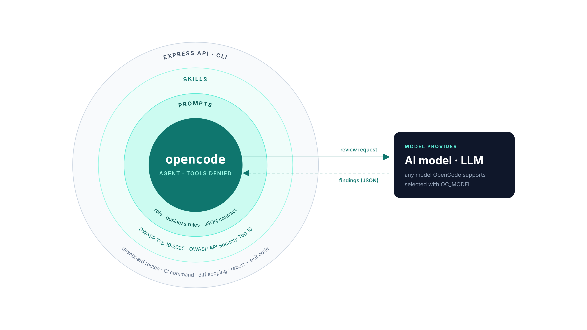

# How it works

← [Back to README](../README.md)



The CLI and the dashboard share one review engine in `src/core/`. Each diff
unit or source batch becomes one prompt: the reviewer's role, the project's
business rules, the security skills, the code, and a JSON contract for the
answer. OpenCode sends it to the model and returns **structured JSON
findings** (`file, line, severity, category, message, suggestion`), which are
aggregated into `review-report.md` and `review-report.json`.

```
Git refs or unified diff → diff units → reviewer → report + exit code   (CI)
repository               → batches    → reviewer → report + dashboard   (standalone)
```

## Business rules and project context

Both modes read `BUSINESS_LOGIC.md` from the supplied directory. Use it to
describe rules the code must enforce, including who can read or change
records, valid state transitions, and expected edge cases. For example, a todo
app could specify that only the owner can read a todo and that requests by
other users return HTTP 404. See this repository's
[`BUSINESS_LOGIC.md`](../BUSINESS_LOGIC.md) for a sample structure.

The reviewer also reads the first available project context file, typically
`REVIEW_CONTEXT.md` or `ARCHITECTURE.md`. Each review prompt includes the files
it finds. If neither business rules nor project context are available, the
reviewer emits a warning. See
[`REVIEW_CONTEXT.template.md`](../REVIEW_CONTEXT.template.md) for architecture
and conventions.

## Security skills

Every CI diff and dashboard batch includes the reviewer image's
[OWASP Web Top 10 2025 skill](../skills/owasp-web-review/SKILL.md) and
[OWASP API Security Top 10 2023 skill](../skills/owasp-api-review/SKILL.md).
The reviewer loads them before calling OpenCode. If either skill is missing or
unreadable, the batch fails. The skills ask for evidence tied to the code in
scope and direct the model to record checks it could not verify in the batch
summary.

## Model

DeepSeek via OpenCode. Set `DEEPSEEK_API_KEY` at runtime, or save it in the
dashboard's Settings. Reviews send the selected source or diff and project
context to the configured model provider. The provider is configured in
[`opencode.json`](../opencode.json); defaults live in
[`review.config.json`](../review.config.json).

## Batches and large files

Files and diffs over the configured size limits are split into several
batches: files by line range, diffs by hunk. Only a single line longer than
the limit, such as minified code, is clipped. The report lists the affected
files and marks the review incomplete, so CI exits `3`. Exclude generated or
minified files to avoid this.

## Tokens and cost

The dashboard and reports sum input tokens (including cache reads and writes),
output tokens (including reasoning), and the estimated USD cost from OpenCode.
Totals use the usage records OpenCode emits. Missing records or pricing are
marked as unavailable or partial. Provider billing can differ from the
estimate.
